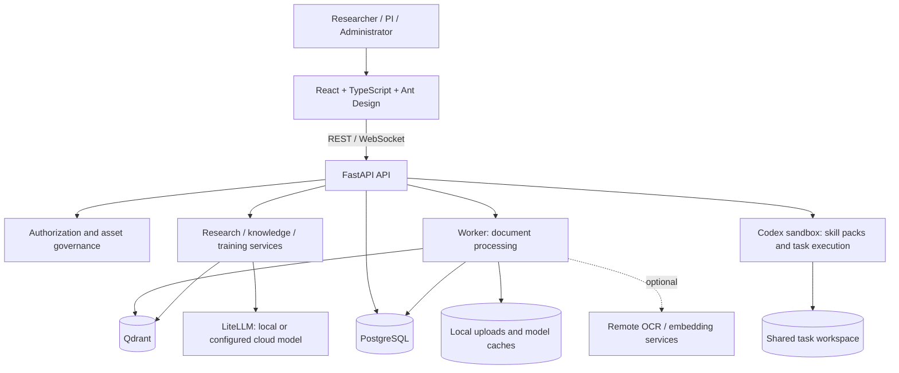

# OpenColab Core

[English](README.md) | [简体中文](README.zh-CN.md)

**A local-first AI research workspace for scientific teams.**

OpenColab Core brings project documents, evidence-based AI conversations, laboratory knowledge, and training into one self-hosted workspace. Teams can connect local models or configured cloud providers while retaining control over their research materials and access policies.

This repository is the public foundation of OpenColab. It includes the project workspace, laboratory knowledge governance, adaptive learning and Codex sandbox skill packs. Domain-specific antimicrobial peptide screening and vaccine design implementations are excluded. See the [extraction and maintenance guide](docs/core-extraction.md) for scope and upgrade boundaries.

[Documentation](docs/README.md) · [Deployment](docs/deployment.md) · [User guide](docs/user-guide.md) · [Architecture](docs/architecture.md) · [Development history](CHANGELOG.md)

## Who it is for

| User | Main workflows |
|---|---|
| Researchers and students | Organize materials, ask questions with citations, run research tasks, learn from lab resources |
| PIs and lab directors | Coordinate projects, curate research directions and resources, review knowledge contributions, assign training |
| Knowledge stewards | Maintain directions, member profiles, resource freshness, and scoped review queues |
| System administrators | Deploy services, manage users, model profiles, runtime settings, tasks, and skill packs |

## Core capabilities

| Module | Implemented capabilities |
|---|---|
| Project workspace | Project membership and sharing, project instructions, plans and activity feed, materials, sessions, and research memory |
| Library and documents | PDF, DOCX, Markdown, TXT and ZIP ingestion; experimental data packages; processing status; previews; notes, tags and collections; duplicate-upload guidance; bibliographic metadata |
| Evidence-based research | Streaming conversations, selected-source retrieval, citations and research traces, project QA, literature synthesis, research objects and evidence relations |
| Tasks and skill packs | Recommended project tasks, task sessions and progress, persisted orchestration runs, administrator-uploaded versioned `SKILL.md` packs executed through the Codex sandbox |
| Laboratory knowledge | Research direction lifecycle and relations, people profiles, resource catalogs, knowledge exploration, suggestions, delegated review, inbox, maintenance lists and health dashboard |
| Permissions and governance | Versioned assets, classification, discovery/read boundaries, project grants, access requests, review notifications and audit records |
| Adaptive training | Versioned courses, modules and units, resource-grounded lessons and questions, practice and assessments, assignments, learning paths, reports, English/Chinese content switching |
| Administration | User management, LLM profiles and connectivity probes, runtime configuration, task and skill-pack management; English and Simplified Chinese UI |

See the [module guide](docs/modules.md) for implementation locations, dependencies, and limitations. Generated research outputs require review against their source evidence. General autonomous wet-lab execution remains outside the delivered platform.

## Architecture



[Detailed architecture and data flows](docs/architecture.md)

## Data locality and offline operation

Self-hosting is the foundation, but deployment configuration determines what leaves the host. Local parsing, embeddings, vector storage, and local LLM inference are supported. Remote PPS OCR can upload a PDF when enabled with a key; cloud embeddings send text; cloud LLMs receive selected context. Bibliographic lookup can query external identifier services.

For an air-gapped deployment, preinstall model weights, use a compatible local LLM endpoint, disable remote OCR and cloud embedding fallback, and keep external integrations off. Optional integrations are not all governed by one global offline switch. Follow the [offline checklist](docs/deployment.md#offline-deployment-and-data-boundaries) before importing private data.

## Quick start

Requires Docker with a recent Compose v2 plugin supporting `!override`, host `curl`. Storage and compute requirements depend on document volume and enabled local models; see [deployment prerequisites](docs/deployment.md#prerequisites).

```bash
cp .env.template .env
```

Edit `.env` locally and set these values before starting:

- `OPENCOLAB_SECRET_KEY`: a strong JWT signing secret.
- `POSTGRES_USER`, `POSTGRES_PASSWORD`, and `POSTGRES_DB`: database configuration.
- `OPENCOLAB_ADMIN_PASSWORD`: initial `admin` password; there is no built-in password.
- `OPENCOLAB_CODEX_RUNTIME_API_KEY`: shared sandbox authentication secret.
- `OPENCOLAB_LLM_MODEL`, `OPENCOLAB_LLM_API_BASE`, and, when needed, `OPENCOLAB_LLM_API_KEY`: model endpoint configuration. Model profiles can subsequently be managed in the UI.

To serve the built frontend through nginx, set this line in `.env` **before building**:

```dotenv
COMPOSE_FILE=docker-compose.yml:docker-compose.test.yml
```

Without it, Compose starts Vite and an API reloader for development.

```bash
./scripts/docker-build.sh
./scripts/docker-start.sh
```

Open [http://localhost:8430](http://localhost:8430), sign in as `admin` using your configured password, then configure models and create a project.

| Service | Default host address | Purpose |
|---|---|---|
| `frontend` | `http://localhost:8430` | Vite or nginx frontend |
| `api` | `http://localhost:8431` | FastAPI; [interactive API docs](http://localhost:8431/docs) |
| `worker` | No published port | Document parsing, chunking and embedding |
| `postgres` | `localhost:8432` | Relational storage |
| `qdrant` | `localhost:8433` | Vector search |
| `codex-sandbox` | `127.0.0.1:8434` | Authenticated task runtime |

```bash
curl -fsS http://localhost:8431/api/v1/health
curl -fsS http://localhost:8430/api/v1/health
docker compose ps
docker compose logs -f api worker
./scripts/docker-stop.sh
```

Stopping normally preserves data. The `--volumes` option deletes persistent database/vector volumes. For upgrades, backups, offline setup, host development, and troubleshooting, use the [full deployment guide](docs/deployment.md).

## Development history

The core repository was extracted on **2026-10-29** from OpenColab commit `4fa8324`, with a clean source snapshot and no original Git history. General platform functionality includes:

- September–October 2026: bibliographic metadata, resource previews and access-control fixes.
- August 2026: laboratory knowledge directories, stewardship, review, maintenance dashboards and adaptive training.
- July 2026: model profiles, research objects, task orchestration, governed assets, skill packs and multi-format ingestion.
- April–June 2026: workspace, document processing, project sharing, citations and traces.

[Development history](CHANGELOG.md) · [Extraction and future maintenance](docs/core-extraction.md)

## Documentation

- [Documentation hub](docs/README.md): maintained guides and links to detailed module references.
- [User guide](docs/user-guide.md): projects, knowledge and learning workflows.
- [Module guide](docs/modules.md): current capabilities, boundaries, code and test map.
- [Architecture](docs/architecture.md): services, storage, execution and trust boundaries.
- [Deployment](docs/deployment.md): Compose modes, configuration, artifacts, verification, updates and recovery.
- [Development and contribution guide](docs/development.md): local setup, tests, API discovery and conventions.

## Repository layout

```text
frontend/          React application, API clients, locales
backend/app/       FastAPI routes, schemas, models, services, workflows and worker
backend/alembic/   Database migrations
codex-sandbox/    Codex task runtime service
scripts/          Deployment, local development, tool checks and model utilities
tests/            API, service and governance regression tests
docs/             User, operator, architecture and module documentation
```

## Contributing and license

Use the [development guide](docs/development.md) for setup and contribution checks. Keep changes small, add regression coverage for behavior changes, use i18n for UI text, and never commit credentials or local research data.

OpenColab source code is licensed under [Apache License 2.0](LICENSE). Third-party dependencies and model weights retain their own licenses. Preserve required copyright and attribution notices.
