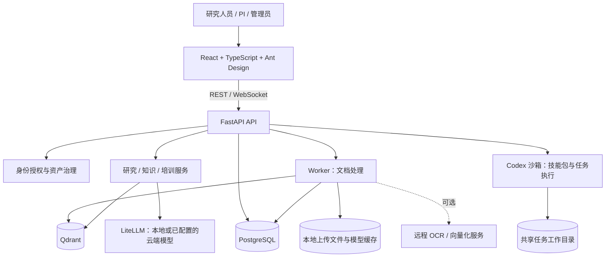

# OpenColab Core

[English](README.md) | [简体中文](README.zh-CN.md)

**面向科研团队、以本地部署为基础的 AI 科研工作空间。**

OpenColab Core 将项目文档、基于证据的 AI 对话、实验室知识和培训整合到一个可自主部署的工作空间中。团队可以接入本地模型或配置云端模型服务，同时掌握科研资料与访问权限的管理权。

本仓库是 OpenColab 的开源基础平台，包含项目工作空间、实验室知识治理、自适应培训和 Codex 沙箱技能包，不包含抗菌肽筛选与疫苗设计的领域实现。拆分范围及后续维护方式见[迁移说明](docs/core-extraction.md)。

[文档中心](docs/README.md) · [部署指南](docs/deployment.md) · [用户指南](docs/user-guide.md) · [系统架构](docs/architecture.md) · [开发历史](CHANGELOG.md)

## 面向用户

| 用户 | 主要使用场景 |
|---|---|
| 研究人员与学生 | 整理资料、进行带引用的问答、运行科研任务、学习实验室资源 |
| PI 与实验室负责人 | 协调项目、维护研究方向与资源、审核知识贡献、分配培训任务 |
| 知识维护者 | 维护研究方向、成员档案和资源时效性，处理授权范围内的审核事项 |
| 系统管理员 | 部署服务，管理用户、模型配置、运行设置、任务和技能包 |

## 核心功能

| 模块 | 已实现能力 |
|---|---|
| 项目工作空间 | 项目成员与共享、项目指令、计划与动态、项目资料、会话和研究记忆 |
| 资料库与文档 | PDF、DOCX、Markdown、TXT 和 ZIP 导入；实验数据包；处理状态；内容预览；笔记、标签与集合；重复上传提示；文献元数据 |
| 基于证据的研究 | 流式对话、指定来源检索、引用与研究轨迹、项目问答、文献综合、研究对象与证据关系 |
| 任务与技能包 | 项目推荐任务、任务会话与进度、编排运行记录持久化；管理员上传带版本的 `SKILL.md` 技能包，并通过 Codex 沙箱执行 |
| 实验室知识 | 研究方向生命周期与关联、成员档案、资源目录、知识探索、知识建议、委托审核、收件箱、维护清单与健康度看板 |
| 权限与治理 | 资产版本、数据分类、发现与读取权限区分、项目授权、访问申请、审核通知与审计记录 |
| 自适应培训 | 课程版本、模块与单元、基于资料的课程和问题、练习与考核、任务分配、学习路径、报告及中英文内容切换 |
| 系统管理 | 用户管理、LLM 配置与连通性测试、运行配置、任务与技能包管理；英文与简体中文界面 |

各模块的实现位置、依赖和限制见[模块说明](docs/modules.md)。生成的研究结论需要结合来源证据审核。通用的自主湿实验执行不在当前已交付平台的能力范围内。

## 系统架构



[详细架构与数据流](docs/architecture.md)

## 数据本地性与离线运行

自主部署是基础，但实际有哪些数据离开主机，取决于部署配置。平台支持本地解析、向量化、向量存储和本地 LLM 推理。远程 PPS OCR 在启用并配置密钥后可能上传 PDF；云端向量化会发送文本；云端 LLM 会接收选定上下文。文献元数据查询也可能访问外部标识符服务。

如需完全隔离网络部署，应提前安装模型权重，使用兼容的本地 LLM 端点，关闭远程 OCR、云端向量化回退和其他外部集成。各项可选集成并非都受同一个全局离线开关控制。导入私有数据前，请完成[离线部署检查](docs/deployment.md#offline-deployment-and-data-boundaries)。

## 快速开始

需要 Docker，以及支持 `!override` 的较新 Compose v2 插件；主机需安装 `curl`。存储与算力需求取决于文档规模及启用的本地模型，详见[部署前置条件](docs/deployment.md#prerequisites)。

```bash
cp .env.template .env
```

在本机编辑 `.env`，启动前设置以下配置：

- `OPENCOLAB_SECRET_KEY`：高强度 JWT 签名密钥。
- `POSTGRES_USER`、`POSTGRES_PASSWORD` 和 `POSTGRES_DB`：数据库配置。
- `OPENCOLAB_ADMIN_PASSWORD`：初始 `admin` 密码，系统没有内置默认密码。
- `OPENCOLAB_CODEX_RUNTIME_API_KEY`：沙箱服务共享认证密钥。
- `OPENCOLAB_LLM_MODEL`、`OPENCOLAB_LLM_API_BASE`，以及需要时的 `OPENCOLAB_LLM_API_KEY`：模型端点配置。后续可通过管理界面维护模型配置。

如果希望通过 nginx 提供构建后的前端，请在**构建之前**将以下配置写入 `.env`：

```dotenv
COMPOSE_FILE=docker-compose.yml:docker-compose.test.yml
```

未设置时，Compose 会启动用于开发的 Vite 服务和 API 自动重载器。

```bash
./scripts/docker-build.sh
./scripts/docker-start.sh
```

打开 [http://localhost:8430](http://localhost:8430)，使用 `admin` 和自行配置的密码登录，然后配置模型并创建项目。

| 服务 | 默认主机地址 | 用途 |
|---|---|---|
| `frontend` | `http://localhost:8430` | Vite 或 nginx 前端 |
| `api` | `http://localhost:8431` | FastAPI；[交互式 API 文档](http://localhost:8431/docs) |
| `worker` | 不发布主机端口 | 文档解析、切分和向量化 |
| `postgres` | `localhost:8432` | 关系数据存储 |
| `qdrant` | `localhost:8433` | 向量检索 |
| `codex-sandbox` | `127.0.0.1:8434` | 经过认证的任务运行服务 |

```bash
curl -fsS http://localhost:8431/api/v1/health
curl -fsS http://localhost:8430/api/v1/health
docker compose ps
docker compose logs -f api worker
./scripts/docker-stop.sh
```

正常停止会保留数据。`--volumes` 选项会删除数据库和向量库的持久化卷。升级、备份、离线安装、主机开发模式及故障排查步骤见[完整部署指南](docs/deployment.md)。

## 更新历史

本仓库于 **2026-10-29** 从 OpenColab 提交 `4fa8324` 提取通用平台源码，不包含原仓库 Git 历史。

- 2026 年 9—10 月：文献元数据、资源预览和访问权限修复。
- 2026 年 8 月：实验室知识目录、维护者、审核、维护看板及自适应培训。
- 2026 年 7 月：模型配置、研究对象、任务编排、受控资产、技能包及多格式导入。
- 2026 年 4—6 月：工作空间、文档处理、项目共享、引用与研究轨迹。

[开发历史](CHANGELOG.md) · [拆分与后续维护](docs/core-extraction.md)

## 文档导航

除标明中文版的文档外，以下指南目前以英文为主。

- [文档中心](docs/README.md)：维护中的指南及详细模块文档入口。
- [用户指南](docs/user-guide.md)：项目、知识和学习工作流。
- [模块说明](docs/modules.md)：当前能力、功能边界、代码与测试位置。
- [系统架构](docs/architecture.md)：服务、存储、执行流程与信任边界。
- [部署指南](docs/deployment.md)：Compose 模式、配置、模型文件、验证、升级与恢复。
- [开发与贡献指南](docs/development.md)：本地环境、测试、API 文档及开发规范。

## 仓库结构

```text
frontend/          React 应用、API 客户端、语言资源
backend/app/       FastAPI 路由、数据契约、模型、服务、工作流与 worker
backend/alembic/   数据库迁移
codex-sandbox/     Codex 任务运行服务
scripts/           部署、本地开发、工具检查与模型管理脚本
tests/             API、服务与治理回归测试
docs/              用户、运维、架构及模块文档
```

## 参与贡献与许可证

环境搭建与贡献检查步骤见[开发指南](docs/development.md)。请保持改动小而易于审查，为行为变化补充回归测试，界面文本使用 i18n，避免提交凭据或本地科研数据。

OpenColab 源代码采用 [Apache License 2.0](LICENSE)。第三方依赖与模型权重遵循各自的许可证，使用和分发时需保留要求的版权及署名声明。
