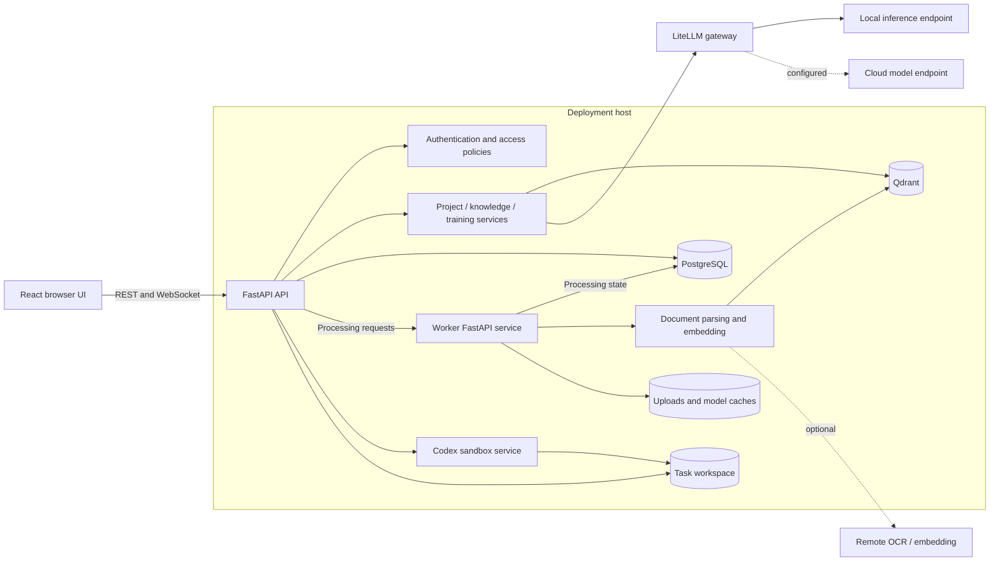

# System architecture

OpenColab is a self-hosted research workspace with a browser UI, an application API, a document worker, a Codex runtime service, and local persistence. Its main product flow is document-grounded research; knowledge governance and adaptive training share the same user/project foundation.

## Service topology

Compose service names are `frontend`, `api`, `worker`, `codex-sandbox`, `postgres`, and `qdrant`. The worker has no published port in Compose; the sandbox is published only on loopback. See [deployment](deployment.md) for ports and run modes.

## Application layers

| Layer | Implementation | Responsibility |
|---|---|---|
| Browser | `frontend/src/` | React 19, TypeScript, Ant Design, React Query, routing and previews; en-US/zh-CN i18n |
| API | `backend/app/api/` | FastAPI authentication, resource endpoints and WebSocket streaming |
| Contracts | `backend/app/schemas/` | Pydantic request/response validation |
| Persistence | `backend/app/models/`, `backend/alembic/` | SQLAlchemy models and versioned migrations on PostgreSQL |
| Business services | `backend/app/services/` | Access checks, retrieval, knowledge, training and task orchestration |
| Research execution | `backend/app/workflows/`, `backend/app/services/codex_runtime.py` | Built-in workflows, persisted run context and sandbox execution |
| Background execution | `backend/app/worker/main.py` | Parsing/embedding endpoints and document processing |
| Task runtime | `codex-sandbox/server.py` | Authenticated Codex execution against a shared filesystem workspace |

Research-agent and built-in workflow execution lives in the application services, while uploaded skill packs execute through the Codex runtime. These are distinct paths. The code-defined built-in workflow registry remains; the old user-defined declarative skill/workflow extension system has been replaced by skill packs.

## Main data flows

### Document ingestion and research QA

1. An authorized user uploads a source or data package and associates it with a library/project context.
2. The system records source/asset state, revisions, access policy and processing status.
3. The worker parses documents, chunks extracted text and generates embeddings. Qdrant stores vectors; relational state and metadata remain in PostgreSQL; files stay in local storage unless a remote parser is configured.
4. A session or task resolves the permitted project context and selected sources. Retrieval uses the query and access boundaries to choose evidence.
5. A configured model generates an answer. Messages, citations, research traces, task runs and research memory provide persisted context for later review.

### Tasks and skill packs

Task definitions select the workflow/runtime and presentation. Orchestration records preserve run identity, context and state. The API exports task context to a shared workspace; the sandbox executes the selected skill pack and returns progress and output. An uploaded pack is executable functionality and should be reviewed by the administrator who installs it. The sandbox service name is not a guarantee of a restricted execution policy: Compose currently selects `danger-full-access` inside that service.

### Laboratory knowledge and learning

Research directions link projects, people and resources. Scoped stewards review suggestions and maintain freshness. Knowledge exploration respects request-time authorization. Training courses reference authorized materials and persist versions, lessons, evidence, assignments and assessment progress; model-generated lessons/questions depend on the configured LLM.

## Persistence and operational boundaries

| State | Storage |
|---|---|
| Users, projects, grants, messages, knowledge, training, runs | PostgreSQL |
| Retrieval vectors | Qdrant |
| Uploaded files and result files | `uploads/` host directory |
| Downloaded model caches | `models/` host directory |
| Task context and sandbox artifacts | `codex-workspace/` host directory |
| Uploaded skill packs | `backend/skill-packs/` |

Database state alone is not a complete backup. Preserve matching files, vectors, artifacts and configuration; see [backup and restore](deployment.md#backup-and-restore).

## Data trust boundaries

Authorization is enforced in API/service logic, including discoverability versus content access, project-scoped grants, and request-time knowledge visibility. Frontend filtering is not the security boundary. See the [security contract](lab-knowledge-os-v1-security-contract.md) and [project material access](project-material-access.md).

Local-first deployment requires deliberate provider configuration. Remote PPS can upload original PDFs, external embeddings send text, cloud model calls send selected context. Bibliographic providers receive identifiers. The platform has separate integration switches rather than one universal offline mode; use the [offline deployment checklist](deployment.md#offline-deployment-and-data-boundaries).
