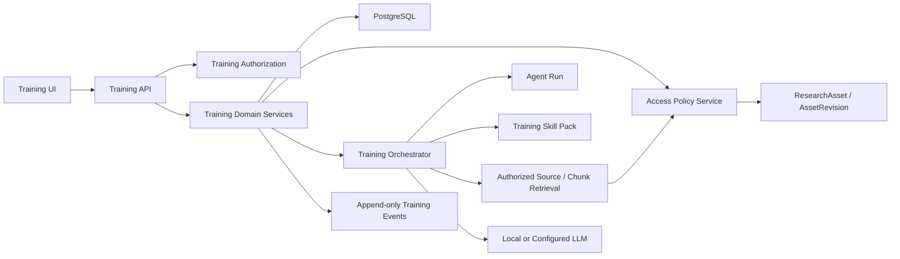
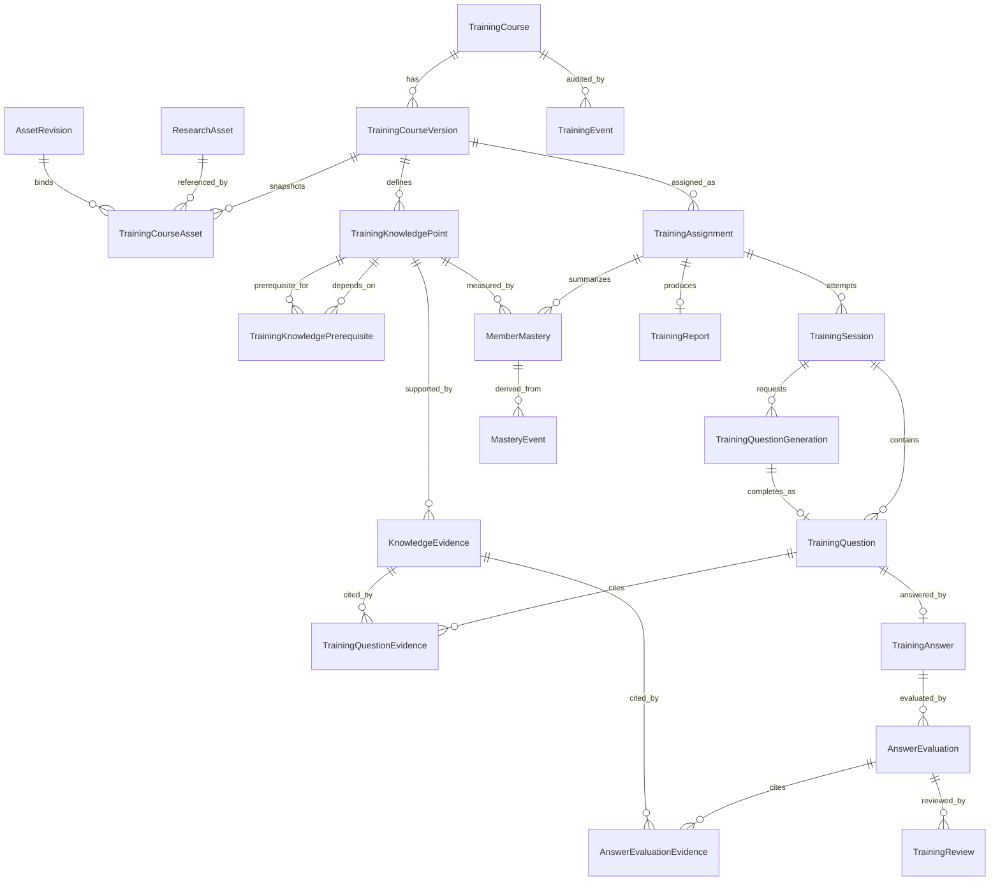
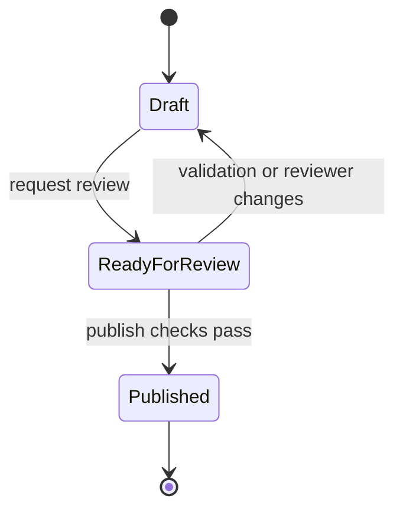
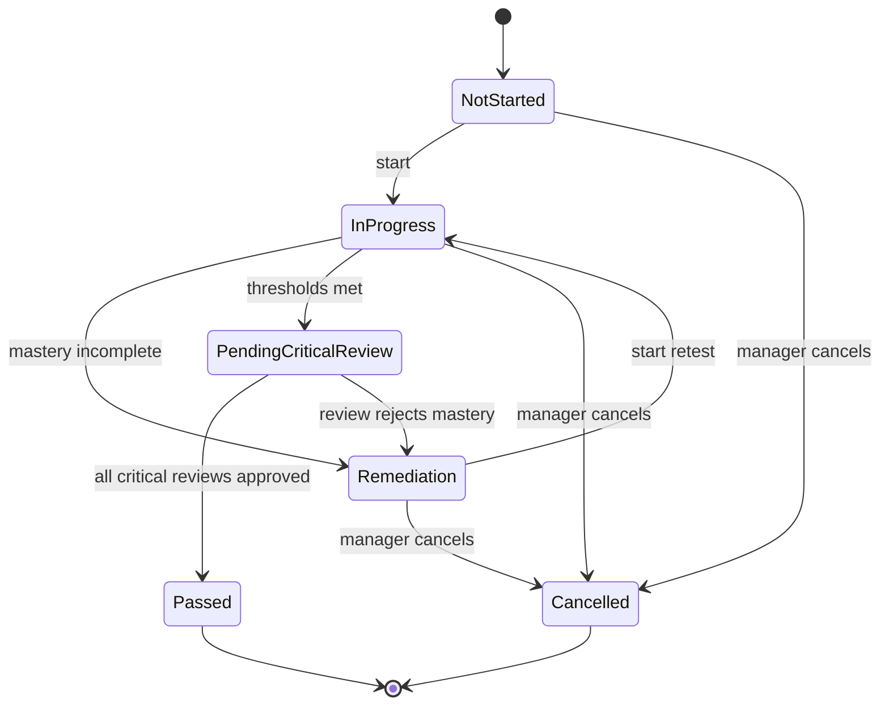
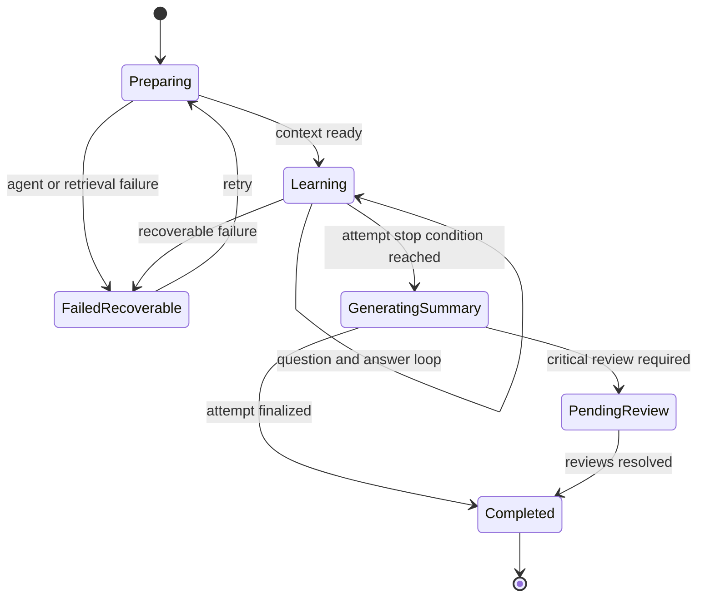

# OpenColab Adaptive Training v1 技术设计

**状态：** 待评审

**版本：** v0.1

**日期：** 2026-08-12

**来源 PRD：** [OpenColab Adaptive Training v1 PRD](./2026-08-12-adaptive-training-v1-prd.zh-CN.md)

## 1. 设计目标

本设计把已批准 PRD 映射到 OpenColab 当前架构。Phase 0–3 是 Training Foundation Pilot，仅交付课程发布、分配、一道有证据的问题、评价和证据阅读；不把它表述为已完成自适应闭环。完整 v1 路线图目标是：

1. 交付课程创建、知识点审核、自适应训练、补学重测、关键知识复核和报告闭环。
2. 复用 ResearchAsset、AssetRevision、AccessPolicy、Source、Chunk、Agent Run 和 Skill Pack。
3. 保持 Training 领域状态独立，不污染普通聊天 Session、ResearchObject 或通用工作流定义。
4. 保证课程版本、题目、回答、评价、掌握度和人工改判可追溯、可重放。
5. 保证资料权限在请求时与模型调用前均被强制执行。
6. 支持本地模型和完全离线部署。

## 2. 架构概览

核心边界：

- Training API 不允许客户端直接提交“已通过”或任意掌握度。
- Training Agent 不直接修改课程发布状态、Assignment 状态或关键知识确认状态。
- 所有 Agent 输出先通过结构化 Schema 校验，再由领域服务决定是否接受。
- Access Policy 是资料访问的唯一事实来源，Training 不建立平行资料权限表。

## 3. Durable Architectural Decisions

### 3.1 路由

前端路由：

- `/training`：成员培训列表。
- `/training/sessions/:sessionId`：训练会话。
- `/training/reports/:assignmentId`：培训报告。
- `/training/admin`：课程与分配管理。
- `/training/admin/courses/:courseId`：课程编辑和版本详情。
- `/training/reviews`：关键知识和低置信度复核队列。

后端路由统一位于 `/api/v1/training`：

- `/courses` 与 `/courses/{courseId}`。
- `/courses/{courseId}/versions`。
- `/course-versions/{versionId}/knowledge-points`。
- `/course-versions/{versionId}/publish`。
- `/assignments` 与 `/assignments/{assignmentId}`。
- `/sessions` 与 `/sessions/{sessionId}`。
- `/sessions/{sessionId}/next-question`。
- `/questions/{questionId}/answers`。
- `/evidence/{evidenceId}/preview-token` 与 `/evidence/{evidenceId}/content`。
- `/reviews` 与 `/reviews/{reviewId}/resolve`。
- `/assignments/{assignmentId}/report`。

所有列表使用游标分页，排序键由 `created_at` 与 `id` 组成，游标不暴露数据库实现细节。

### 3.2 数据库

- PostgreSQL 是正式运行数据库，SQLite 继续用于单元测试。
- 所有外键建立索引。
- 课程版本和培训事实不硬删除；归档或取消通过状态表达。
- 发布、答题、评价、复核和掌握度更新使用数据库事务。
- 并发答题、复核和发布使用行级锁或等价的乐观并发控制。
- 所有时间在数据库中使用带时区时间戳。

### 3.3 API 契约

- Pydantic V2 负责输入和结构化 Agent 输出校验。
- 状态冲突返回 `409`，无权限返回 `403`，资源不存在返回 `404`，非法状态或游标返回 `422`。
- 错误响应包含稳定错误代码，界面通过 i18n 映射用户文案。
- 创建题目、提交答案、解决复核等写操作支持幂等键，防止重试产生重复事实。

### 3.4 前端数据访问

- 继续使用统一 Axios client。
- 新 Training hooks 使用 React Query 管理缓存、失效和轮询。
- Agent 长任务采用创建任务后轮询状态的方式；若后续需要流式反馈，再复用现有 WebSocket 基础。
- Agent 状态响应提供建议的下次轮询间隔；React Query 使用有上限的指数退避和随机抖动，页面不可见时暂停，恢复可见时立即刷新，进入终态后停止。
- 超过总等待上限时界面停止自动轮询并展示当前安全状态和手动重试入口；刷新页面继续以服务端事实恢复，不重建任务。
- Training Session 的恢复依据服务端状态，浏览器本地仅保存非关键 UI 偏好。

### 3.5 Durable Agent Job Execution

- Training Agent 长任务复用现有 Worker 可执行代码与 PostgreSQL 持久任务记录，但不与 Source 任务共享 OS 进程；不使用请求内 `BackgroundTasks`，不在 v1 引入 Celery、Redis 或 RabbitMQ。
- AgentRun 增加明确的 `resource_class`（至少 `source_cpu`、`training_io`、`training_local_gpu`）、领取租约、递增 `claim_generation`、领取时间、心跳时间、重试次数和下次可执行时间。
- Worker 从现有 Source 任务轮询中抽取共享领取骨架，同一代码包按启动参数运行独立进程池。Source Worker 只领取 `source_cpu`，Training Worker 只领取 `training_io`，本地模型启用时由专用 GPU Worker 领取 `training_local_gpu`；任务不得在不兼容进程池间降级执行。
- 每个进程池拥有独立的并发上限、连接预算、健康检查和优雅停止流程。进程池可以部署在同一主机，不要求新增消息代理或独立服务产品。
- 公平性在每个进程池的同资源队列内部实现；跨资源类别的隔离由独立进程保证。单一进程池崩溃、内存峰值或事件循环阻塞不得停止其他进程池领取任务。
- 每个 Training `resource_class` 配置待领取任务硬上限。创建任务的短事务先检查对应队列容量；达到上限时不创建 AgentRun，返回 HTTP 503、稳定错误码 `TRAINING_QUEUE_SATURATED` 和 `Retry-After`。已持久化的 Session、Answer、Generation 或其他领域事实保持可恢复，不因背压回滚或丢失。
- Foundation Pilot 容量包线为 5 名同时活跃学员和 10 个突发出题/评价请求；在对应进程池健康且存在可用并发名额时，从提交到首次领取的 p95 小于 5 秒。超出包线不承诺延迟，但仍必须遵守队列上限、权限和数据完整性。
- 模型执行总耗时按版本化性能档案验收：云端模型档案与每种批准的离线模型/硬件档案分别保存阈值和测量结果。领取延迟与模型推理耗时分开报告。
- Training 任务使用 `FOR UPDATE SKIP LOCKED` 原子领取，每个并发任务使用独立 AsyncSession。
- 每次领取或接管递增 `claim_generation`；心跳、状态更新和最终领域写入都以 `(agent_run_id, claim_generation)` 条件更新，受影响行数为零时视为迟到 Worker 并安全丢弃结果。
- Worker 启动和定期扫描时只回收租约已过期的 Running 任务；未过期任务不能被重复领取。
- Assignment 取消、资料权限撤销、人工重新发起或管理员终止任务时使当前 generation 失效；旧 Worker 不得在这些事件后提交题目、评价或候选知识点。
- 超过重试上限的任务进入明确 Failed 状态，保存稳定错误码并允许有权限用户重新发起，不进行无限重试。
- Worker 终止、模型超时和数据库短暂不可用均不得丢失已提交的 Training 领域事实。

### 3.6 Immutable and Append-only Enforcement

- 领域状态机是所有 Training 状态迁移的唯一入口；已发布 CourseVersion 及其知识点和证据禁止更新或删除。
- 已展示的 TrainingQuestion、已提交的 TrainingAnswer、AnswerEvaluation、TrainingReview、MasteryEvent、TrainingReport 和 TrainingEvent 作为历史事实，只追加新记录，不覆盖旧记录。
- SQLAlchemy `before_update` 和 `before_delete` 守卫沿用 AssetRevision 的模式，阻止 API、Worker 和维护脚本误改受保护记录。
- Training 代码禁止对受保护表使用绕过 ORM 事件的批量 `UPDATE` 或 `DELETE`；状态变化通过显式服务方法和追加事件表达。
- 测试必须直接尝试修改和删除受保护记录，并覆盖并发提交；该机制用于内部培训审计，不宣称能够抵抗数据库管理员篡改或提供法律级存证。

### 3.7 Durable Command Idempotency

- 新增 `TrainingCommandReceipt`，记录 `actor_user_id`、`operation_type`、`idempotency_key`、规范化请求哈希、处理状态、结果对象类型与标识、契约版本、创建时间和过期时间。Receipt 不保存答案、评价、Evidence 或完整响应正文。
- `(actor_user_id, operation_type, idempotency_key)` 唯一；相同键和相同请求哈希返回首次结果，相同键但不同请求哈希返回稳定 `409`。
- 相同请求的重放先验证 Receipt 所属 actor，再按当前用户活跃状态、TrainingAuthorizationService 范围和 AccessPolicy 资料能力重新授权结果对象，并用当前响应契约重新序列化/裁剪。失权返回稳定 403，但命令仍视为已执行，不创建新业务事实。
- Receipt 指向的对象被当前调用者隐藏、归档或依法不可返回时，使用不泄露存在性的当前授权错误；不得通过 Receipt 暴露对象类型、正文或历史权限。
- Receipt 与 Session、Answer、Review 决议或 Agent Run 等业务事实在同一数据库事务中写入；不使用进程内缓存作为幂等事实来源。
- Receipt 保留期按 operation type 和契约版本配置，清理只删除过期的幂等协调记录，不删除或改变 Session、Answer、Review、Agent Run、TrainingEvent 等业务/审计事实。仍处于处理状态或在最大客户端重试窗口内的 Receipt 不得清理。
- 业务表的自然唯一约束继续作为最终防线，例如每题一份正式回答、每个 Assignment 一个活动 Session。
- 创建/恢复 Session、提交回答、解决复核和重新发起 Agent 任务均使用统一 Command Receipt 服务，不在各路由重复实现幂等逻辑。

## 4. Domain Model

### 4.0 Implementation Scope of This Design

Phase 0–3 只实现 TrainingCourse、TrainingCourseVersion、TrainingPolicySnapshot、TrainingCourseAsset、TrainingKnowledgePoint、TrainingKnowledgePrerequisite、KnowledgeEvidence、TrainingDataSubject/Identity Link/Retention、TrainingAssignment、TrainingSession、TrainingQuestionGeneration、TrainingQuestion、TrainingAnswer、题目/评价证据关系、AnswerEvaluation、最小 TrainingReview、TrainingEvent、TrainingAgentRunLink 和 TrainingCommandReceipt。

以下章节中的 MemberMastery、MasteryEvent、补学/重测扩展、集中 Review Inbox、TrainingReport 和聚合报告是 Phase 4–8 的设计接缝，不是 Phase 0–3 的建表、API、UI、迁移或运行测试清单。Phase 3 stop/go 通过后，进入每个阶段前必须基于试点证据重新评审相应 Schema、规则、性能和运营容量；未获批前不得创建占位实现。

### 4.1 TrainingCourse

课程的稳定身份和管理范围：

- `id`
- `name`、`description`
- `scope_type`: `lab` 或 `project`
- `project_id`: 项目课程必填，实验室课程为空
- `lifecycle_status`: `active` 或 `archived`
- `created_by_subject_id`
- `created_at`、`updated_at`

约束：

- `scope_type=project` 时必须存在 `project_id`。
- 归档课程不能创建新 Assignment。
- Project Owner 只能管理其作为 Owner 的项目课程。

### 4.2 TrainingCourseVersion

课程的一次可审核和可发布快照：

- `id`、`course_id`、`version_number`
- `status`: `draft`、`ready_for_review`、`published`
- `description_snapshot`
- `overall_pass_threshold`
- `minimum_coverage_percent`
- `default_due_days`
- `optional_review_after_days`
- `training_policy_snapshot_id`: 指向该版本唯一的不可变训练政策快照
- `created_from_version_id`
- `created_by_subject_id`、`published_by_subject_id`
- `created_at`、`published_at`

约束：

- `(course_id, version_number)` 唯一。
- `draft` 与 `ready_for_review` 共同视为可编辑状态；每门课程同一时间最多存在一个可编辑版本。
- PostgreSQL 部分唯一索引在数据库层约束上述不变量，服务层在写入前预检查并返回稳定冲突错误；数据库约束处理并发竞争的最终兜底。
- Published 版本及其子记录不可修改。
- 发布时必须至少有一个资料、一个知识点、一条有效证据和一份通过模型质量门槛的完整 Training Policy Snapshot。

### 4.2.1 TrainingPolicySnapshot

Course Version 的一对一不可变政策快照：

- `id`、`course_version_id`（唯一）和 `schema_version`
- `skill_pack_id`、`skill_pack_version`
- `prompt_bundle_version`、`output_contract_version`
- `rubric_policy_version`、`context_budget_version`
- `evaluation_rule_version`、`evaluation_routing_policy_version`、`mastery_rule_version`
- `operation_model_profiles_json`: 按知识提取、出题、评价和补学保存请求的 provider/model、参数与离线硬件档案标识
- `snapshot_sha256`
- `created_by_subject_id`、`created_at`

约束：

- Snapshot 在 Course Version 发布后不可修改或替换；Assignment 不保存可覆盖的政策配置，只经 Course Version 继承该快照。
- 发布检查验证所有版本引用存在、结构契约兼容、模型档案健康且已通过对应受控 Eval 门槛。改变任一字段必须创建新的 Course Version。
- Worker 在领取和模型调用前加载绑定 Snapshot，并将 `training_policy_snapshot_id`、哈希、操作类型、请求的模型档案及 provider 实际返回的 model/revision 标识写入 Agent Run。
- 实际返回标识与政策允许范围不符时返回稳定错误 `TRAINING_MODEL_PROFILE_MISMATCH`，不提交派生结果。供应商未暴露的内部模型变化无法保证逐 token 重现，必须通过版本化质量基准和运行记录识别风险。

### 4.3 TrainingCourseAsset

绑定课程版本与不可变资料修订：

- `course_version_id`
- `research_asset_id`
- `asset_revision_id`
- `position`
- `added_by`

约束：

- `(course_version_id, research_asset_id)` 唯一。
- 只能绑定 Ready 且已封存的 AssetRevision。
- 发布前再次验证创建者具有 `content:use_in_agent` 能力。

### 4.4 TrainingKnowledgePoint

- `id`、`course_version_id`
- `stable_key`: 跨版本差异比较用的稳定标识
- `title`、`description`、`category`
- `importance`: `low`、`medium`、`high`、`critical`
- `difficulty`: 1–5
- `required_mastery`: 0–100
- `is_critical`
- `review_status`: `draft`、`approved`、`rejected`
- `created_by_type`: `human` 或 `agent`
- `reviewed_by_subject_id`、`reviewed_at`

约束：

- 发布版本中的所有知识点必须是 Approved。
- `is_critical=true` 时必须设置独立阈值。
- `TrainingKnowledgePrerequisite(knowledge_point_id, prerequisite_knowledge_point_id)` 使用真实外键和组合唯一约束，删除采用 RESTRICT。
- 服务层保证两端属于同一 Course Version，前置关系不能自环，发布检查必须拒绝循环依赖。

### 4.5 KnowledgeEvidence

- `id`、`knowledge_point_id`
- `course_asset_id`
- `asset_content_member_id`: 指向 CourseAsset 所绑定修订中的不可变成员
- `managed_source_id`: 来源追踪
- `origin_chunk_ref`: 可空，保存生成时 Chunk 标识的不可变字符串快照，不建立数据库外键
- `source_content_sha256`: 生成证据时的来源内容哈希
- `locator_json`: 可选页码、章节、字符范围或版面信息
- `excerpt_text`: 受权限保护的有限证据片段
- `excerpt_sha256`
- `review_status`
- `created_by_type`、`reviewed_by_subject_id`、`reviewed_at`

约束：

- Evidence 必须指向 Course Version 已绑定修订中的 AssetContentMember；服务层校验 Source 与该成员一致。
- `excerpt_text` 只保存回答知识点所需的有限片段，不保存完整正文。
- `excerpt_text`、内容哈希、片段哈希和定位信息共同组成课程版本的不可变证据快照；Chunk 重新生成不得改写快照。
- `origin_chunk_ref` 不承担历史完整性且永不因 Chunk 删除、重新切分或 ID 复用而更新；它只用于诊断。权威溯源使用 AssetContentMember、绑定的 AssetRevision、Source 内容哈希和片段哈希。
- Chunk 清理任务不得反向更新 KnowledgeEvidence；发布后的 Evidence 全行受不可变性保护。
- 返回 Evidence 正文前重新验证当前用户的 Preview 权限。
- 历史报告只保存 Evidence 标识和资料元数据，不内嵌正文。

### 4.6 TrainingAssignment

- `id`、`course_version_id`、`trainee_subject_id`
- `status`: `not_started`、`in_progress`、`remediation`、`pending_critical_review`、`passed`、`cancelled`
- `assigned_by_subject_id`
- `available_from`、`due_at`、`review_at`
- `started_at`、`completed_at`、`cancelled_at`
- `row_version`: 乐观并发版本

约束：

- Assignment 创建后固定 Course Version。
- 状态只允许经过状态机转换。
- 取消不删除 Session、Answer 或事件。

### 4.6.1 TrainingDataSubject and Identity Link

- `TrainingDataSubject(id, pseudonymous_ref, created_at)` 是 Training 事实使用的不可逆内部主体标识，不保存姓名、邮箱、用户名或可逆哈希。
- `TrainingSubjectIdentityLink(subject_id, user_id, linked_at, unlinked_at)` 是单独受控的当前实名映射；活动映射对 `subject_id` 与 `user_id` 分别唯一。Assignment、Answer、Mastery、Report 和主体相关 TrainingEvent 从创建时只引用 `subject_id`，避免离职时重写不可变事实。
- 成员停用、离职或进入删除流程时，在同一受控流程中撤销 Training 访问、取消未完成任务、使其 Agent job generation 失效，并删除/终止 Identity Link。去标识化事实继续满足引用完整性，但普通产品入口不得按身份查回。
- `TrainingRetentionPolicy` 版本化保存不同数据类别的保留期与动作：回答正文、评价理由、个人报告可清理或最小化；聚合指标须满足小样本抑制；TrainingEvent 仅保留 pseudonymous subject/actor reference 与必要审计字段。具体天数由管理员批准，不硬编码。
- 保留期任务必须使用引用感知的领域清理服务：先删除/最小化正文，再保留必要哈希、状态和引用占位；不得通过级联删除破坏 Evaluation、Review、MasteryEvent 或课程统计的事实链。
- 独立的 `TrainingIdentityErasureLedger` 保存不可逆 subject reference、动作时间和策略版本，不含直接身份信息。数据库/备份恢复后必须在开放 Training 读取前重放该台账，确保旧备份中的 Identity Link 不会恢复可识别性。

### 4.7 TrainingSession

- `id`、`assignment_id`、`attempt_number`
- `status`: `preparing`、`learning`、`generating_summary`、`pending_review`、`completed`、`failed_recoverable`
- `current_knowledge_point_id`
- `agent_checkpoint_json`: 只保存可恢复编排状态，不保存授权外正文
- `started_at`、`last_active_at`、`completed_at`

约束：

- `(assignment_id, attempt_number)` 唯一。
- 同一 Assignment 最多一个未完成 Session。
- 重测创建新 Session，不清空旧 Session。

### 4.8 TrainingQuestion and TrainingAnswer

TrainingQuestionGeneration：

- `id`、`session_id`、`sequence_number`
- `status`: `pending`、`running`、`completed`、`failed_recoverable`、`cancelled`
- `agent_run_id`、`question_id`
- `request_fingerprint`、`error_code`
- `created_at`、`updated_at`

约束：

- `(session_id, sequence_number)` 唯一；下一题接口在短事务内创建或返回同一 Generation，不在数据库锁内等待模型。
- Agent Run、TrainingCommandReceipt 和 Generation 在同一事务中关联；并发标签页轮询同一 Generation。
- 只有当前 Agent Run `claim_generation` 可以把 Generation 完成为一条 Question；失败重试复用同一意图并递增领取 generation。
- Session 完成/取消、Assignment 取消或权限撤销时取消未完成 Generation，迟到结果被 fencing 条件拒绝。

TrainingQuestion：

- `id`、`session_id`、`knowledge_point_id`
- `question_type`: `short_answer`、`explanation`、`scenario_judgment`
- `difficulty`
- `prompt_text`
- `rubric_json`
- `is_critical`
- `agent_run_id`、`model_identifier`、`skill_pack_id`、`skill_pack_version`
- `sequence_number`、`shown_at`

TrainingAnswer：

- `id`、`question_id`、`trainee_subject_id`
- `answer_text`
- `submitted_at`
- `idempotency_key`

约束：

- 题目展示前必须完整写入数据库。
- `(session_id, sequence_number)` 在 TrainingQuestion 中唯一，且每条 Question 必须来自已完成的唯一 TrainingQuestionGeneration。
- 一个题目只能有一条成员正式回答。
- `TrainingQuestionEvidence(question_id, evidence_id, position)` 以外键、组合唯一约束和 RESTRICT 删除保存有序证据；服务层保证 Evidence 属于题目知识点的 Course Version。
- 题目、Rubric 和回答一经产生不可覆盖。
- `idempotency_key` 作为可观测关联值保留，命令重放与冲突判断以 TrainingCommandReceipt 为准。

### 4.9 AnswerEvaluation and TrainingReview

AnswerEvaluation：

- `id`、`answer_id`
- `status`: `proposed`、`accepted`、`superseded`、`rejected`
- `supersedes_evaluation_id`: 可空，指向同一 Answer 的前一条权威评价
- `result`: `correct`、`partially_correct`、`incorrect`、`insufficient_evidence`
- `score`: 0–100
- `reasoning_summary`
- `model_confidence`: 0–1，仅为模型自报诊断值
- `routing_confidence`: 0–1，由系统政策计算
- `routing_decision`: `auto_accept`、`manager_confirmation`、`reject_insufficient_evidence`
- `routing_reason_codes_json`
- `evaluation_routing_policy_version`
- `rubric_version`
- `created_by_type`、`agent_run_id`
- `created_at`

TrainingReview：

- `id`、`evaluation_id`
- `status`: `pending`、`approved`、`overridden`
- `reason_code`
- `reason_text`
- `resolved_result`、`resolved_score`
- `reviewed_by_subject_id`、`reviewed_at`

约束：

- Evaluation 只追加；重新评价先生成 `proposed` 新记录并通过 `supersedes_evaluation_id` 形成显式替代链。
- `result`、`score`、`reasoning_summary`、两类 confidence、路由决定与原因、政策版本、`rubric_version`、`created_by_type`、`agent_run_id`、`supersedes_evaluation_id`、创建时间及证据关联在首次写入后冻结。不可变性指这些评价内容不可覆盖，不排斥下述受控生命周期迁移。
- 只允许 `proposed → accepted`、`proposed → rejected` 和 `accepted → superseded`；禁止回退、跳转、重新激活或修改终态。每次合法迁移追加包含操作者、原因和时间的 TrainingEvent。
- PostgreSQL 迁移用触发器阻止冻结字段更新和非法状态迁移；SQLAlchemy 状态机提供同样的前置校验与稳定错误码。SQLite 快速测试验证服务契约，PostgreSQL 专项测试验证数据库无法被批量 SQL 绕过。
- PostgreSQL 部分唯一索引保证每个 `answer_id` 同时最多只有一条 `status = accepted` 的评价；服务层在写入前提供可读冲突错误。
- 接受新评价必须在同一事务内锁定 Answer 与当前 accepted Evaluation，将旧评价改为 `superseded`、新评价改为 `accepted`，并追加 TrainingEvent。并发替换只有一个事务成功。
- `supersedes_evaluation_id` 必须属于同一 Answer，且不能形成自环或循环；`rejected` 与 `superseded` 记录永不重新成为权威评价。
- `proposed`、`rejected` 和 `superseded` 评价不得创建或更新 Review、MasteryEvent、MemberMastery、补学或通过状态；只有 `accepted` 评价可以驱动这些下游事实。
- EvaluationRoutingPolicy 从 TrainingPolicySnapshot 读取，使用证据覆盖、Rubric 一致性、评分边界、结构校验和受控 Eval 校准参数计算路由；禁止将 `model_confidence` 直接复制为 `routing_confidence` 或作为单一自动接受条件。
- 未校准政策一律 fail closed 为 `manager_confirmation`。只有已通过当前模型/Skill Pack/提示词组合基准门槛的非关键知识评价可以 `auto_accept`；关键知识、低路由置信度、证据不足和策略指定的歧义结果保持 `proposed`。
- Phase 3 在评价详情提供管理范围内的最小单条确认/拒绝动作，并生成 TrainingReview 与 TrainingEvent；改判必须填写原因。Phase 6 在同一领域能力上增加集中 Inbox、筛选和批量运营体验，不复制决议逻辑。
- 学员读取 proposed 评价时只得到 pending-confirmation 状态和安全说明，不返回尚未生效的结论作为权威反馈。
- 相同评价请求的重试通过 TrainingCommandReceipt 和请求指纹返回同一结果，不得生成第二条 accepted 评价或重复下游事件。
- `AnswerEvaluationEvidence(evaluation_id, evidence_id, position)` 以外键、组合唯一约束和 RESTRICT 删除保存评价依据；服务层保证 Evidence 属于回答所对应的 Course Version。
- Critical Knowledge 的高置信度正确结果仍创建 Pending Review。
- 低置信度、证据不足和策略要求人工介入的结果创建 Pending Review。
- 复核解决操作必须具备管理范围并使用事务锁。

### 4.10 MemberMastery and MasteryEvent

MemberMastery 是查询用物化状态：

- `assignment_id`、`knowledge_point_id`
- `mastery_score`: 0–100
- `evidence_count`
- `critical_confirmation_status`
- `last_event_id`、`updated_at`

MasteryEvent 是事实来源：

- `id`、`assignment_id`、`knowledge_point_id`
- `source_type`: `evaluation` 或 `human_review`
- `source_id`
- `previous_score`、`new_score`
- `rule_version`
- `input_snapshot_json`
- `created_at`

约束：

- `(assignment_id, knowledge_point_id)` 在 MemberMastery 中唯一。
- 每次更新锁定 MemberMastery 行并追加 MasteryEvent。
- 可由 MasteryEvent 重放得到相同结果。
- 算法版本改变不重写历史；新事件使用新版本。

### 4.11 TrainingReport and TrainingEvent

TrainingReport 保存完成时的结构化报告快照，不包含受限资料正文：

- Assignment、Course Version 和资料版本引用。
- 总体掌握度、覆盖度和最终状态。
- 每个知识点结果与关键确认状态。
- 补学、重测和人工复核摘要。
- 生成时间和报告 Schema 版本。

TrainingEvent 作为领域审计：

- `aggregate_type`、`aggregate_id`
- `event_type`
- `actor_type`、`actor_subject_id`（成员/管理者事件使用去标识化主体引用；系统事件为空）
- `payload_json`
- `occurred_at`

事件用于审计和通知投影，不作为跨服务消息总线。

## 5. State Machines

### 5.1 Course Version

Published 不允许回退或修改；更改基于 Published 创建下一版本 Draft。

### 5.2 Assignment

### 5.3 Training Session

## 6. Authorization Model

所有 Training 动作通过集中式 `TrainingAuthorizationService` 判定。该服务负责角色、课程范围、项目 Owner、目标成员和对象归属，返回稳定的允许或拒绝决定及原因码；API、领域服务、Worker、报告与导出不得各自复制角色判断。

`TrainingAuthorizationService` 不复制资料权限规则。需要读取资料元数据、正文或把内容送入 Agent 时，它组合调用现有 `AccessPolicyService`。Worker 在实际取数和模型调用前使用当前权限重新判定，不能依赖任务创建时的授权快照。

Training Agent 活动任务持久化用于当前鉴权的 `access_subject_user_id`，并另存长期审计用 `access_subject_id`。课程知识图谱和管理端预览使用发起管理者；成员出题、评价和补学使用对应学员。Worker 在领取后、模型调用前和最终提交前检查该用户仍为活跃用户并重新执行 Training 与资料授权；用户停用、离职、撤权或任务主体与目标成员不一致时使任务失败且不得提交派生结果。任务终态达到保留期限或主体进入删除流程后清除直接 user link，仅保留 pseudonymous subject reference。系统/Worker 身份只负责执行，不拥有额外资料能力。

授权服务提供两类接口：单对象动作判定，以及生成可见范围 SQL 条件并批量预取资料能力。课程、Assignment、Review、Report 和 Evidence 列表必须先在数据库层裁剪范围，再使用 `selectinload` 或显式批量查询加载关联；禁止对分页结果逐条触发授权查询。权限决定不跨请求缓存，保证撤权即时生效。

### 6.1 Domain Permission Matrix

| Action | Admin | PI | Project Owner | Trainee |
|---|---:|---:|---:|---:|
| Create lab course | Yes | Yes | No | No |
| Create project course | Yes | Yes | Own project | No |
| Edit/publish/archive course | All | Lab scope | Own project | No |
| Assign members | All | Managed scope | Own project members | No |
| View personal assignment/session/report | If managed | If managed | If managed | Own only |
| View individual team results | All | Managed scope | Own project | No |
| Resolve review | All | Managed scope | Own project | No |
| View aggregate dashboard | All | Managed scope | Own project | No |

PI 的 “Managed scope” 在 v1 视为单实验室全局范围。未来多实验室化时必须增加显式 `lab_id`，不能继续依赖角色推断。

### 6.2 Asset Capability Requirements

- 课程选材、知识点提取、出题和评价：`content:use_in_agent`。
- Material Reader 和返回 Evidence 正文：`content:preview`。
- 资料元数据展示：`metadata:view`。
- Training 不要求或隐式赋予 `content:download`。

`content:use_in_agent` 同时适用于本地与云端 Agent，不新增 locality 专用资料能力。系统默认本地运行；云端调用仍必须由用户明确启用 hybrid 模式，只发送完成当前任务所需的最少预处理片段，永不发送原始文件或 PDF。Agent Run 记录实际 provider locality、运行时 hybrid 选择、授权决定标识和片段哈希，不记录正文。

发布时确认管理者和目标范围具备适当授权；运行时仍逐次校验。目标成员无 Preview 权限时，课程分配必须阻止或明确列出阻断资料，不能创建一个天然无法完成的培训。

## 7. Training Agent Design

### 7.1 Responsibilities

Training Agent 只负责：

- 从授权资料提出候选知识点和证据。
- 依据已批准知识点、证据和 Rubric 生成题目。
- 依据回答、Rubric 和证据提出结构化评价。
- 根据薄弱知识点推荐证据片段和复测策略。
- 生成报告叙述摘要。

Training Agent 不负责：

- 判断调用者权限。
- 发布课程。
- 修改 Assignment 或 Session 状态。
- 直接写掌握度。
- 确认关键知识通过。
- 授予任何系统权限。

### 7.2 Structured Outputs

每类 Agent 操作有独立、版本化的输出 Schema：

- `KnowledgeMapProposalV1`
- `QuestionProposalV1`
- `AnswerEvaluationProposalV1`
- `RemediationProposalV1`
- `ReportNarrativeProposalV1`

输出必须引用输入中提供的 Knowledge Point 和 Evidence 标识。未知标识、空证据、分值越界或自由创建资料引用时整体拒绝。

### 7.2.1 Context Budget

- 每类 Agent 操作定义独立、版本化的 Context Budget，至少包含最大候选 Chunk 数、最终 Chunk 数、输入字符/token 数、单 Evidence 片段长度、回答长度和输出长度。
- 数据流固定为：当前权限过滤 -> Course Version/Knowledge Point 范围过滤 -> 检索 -> Source 与片段去重 -> 相关性排序 -> 硬预算截断 -> 结构化输入组装。
- 不能先拼接全文再截断；未经授权或不属于当前 Course Version 的内容在预算计算前即移除。
- 云端和离线模型可以配置不同软预算，但不得超过统一隐私与内存硬上限；实际预算版本写入 Agent Run。
- 无法在预算内形成足够证据时返回稳定、可恢复错误，不静默降级为无证据生成。
- Agent Run 只保存标识、哈希、预算使用量和必要的恢复状态，不持久化整份 prompt 正文。

### 7.2.2 Supported Offline Endpoint

- 离线 Training 通过现有 LiteLLM 接入管理员部署在本机或受控局域网的 OpenAI-compatible 端点（包括兼容的 Ollama 部署）；v1 不下载、打包或分发模型权重，也不向 Docker Compose 增加必选模型服务。
- `OfflineModelHardwareProfile` 是版本化的验收配置，至少保存端点类型、模型摘要/不可变标识、上下文窗口、结构化输出能力、推理参数、最低 CPU/GPU/显存/内存和对应性能门槛；不保存密钥。
- TrainingPolicySnapshot 只能引用已批准且健康检查通过的离线档案。Worker 校验实际返回模型标识与档案一致；端点不可达、资源不足、上下文不足或标识不匹配分别返回稳定可恢复错误，不自动回退云端。
- Phase 2/3 的离线验收环境必须阻断外网并记录网络出口检查、provider locality、请求目标和零云调用证明；原始文件/PDF 与预处理片段均不得离开本机或批准的受控局域网边界。
- 管理员负责部署模型和满足硬件前提；OpenColab 负责配置验证、健康检查、契约适配、质量/性能验收与清晰错误提示。

### 7.2.3 Deterministic Test Provider

- 提供仅在 `OPENCOLAB_ENV=test` 且显式测试开关开启时可注册的 in-process `DeterministicTrainingProvider`；配置解析在 dev、uat 或 prod 发现该 provider 时启动失败。它不暴露管理界面选项，也不接受网络请求。
- Provider 根据版本化 fixture ID、操作类型和 scenario key 返回固定结果，至少覆盖合法结构化输出、未知 Evidence、越界分数、证据不足、可重试超时、最终失败和阻塞后迟到结果；fixture 不包含真实资料或成员答案。
- 测试调用仍经过真实的模型网关适配后契约、Agent Run、PostgreSQL 队列、独立 Worker 进程、租约/心跳/fencing、结构校验、权限复核和事务性领域写入。不得在 Worker 集成测试中直接 mock Training Agent 服务方法。
- 单元测试可以 mock 纯函数或边界接口，但不能替代确定性 Provider 的进程级集成门槛。Provider 证明工程链路可预测，受控云端/离线 Eval 证明内容质量，两者结果不得互相替代。

### 7.3 Agent Run Integration

现有 Agent Run 强制关联普通 Session，不能直接表达课程知识图谱任务或 Training Session。Agent Run 继续作为通用执行账本，不增加 Training 专用上下文列：

- 现有 `session_id` 改为可空，保留全部历史聊天关联。
- `session_id` 外键删除行为由 `CASCADE` 改为 `SET NULL`，关系与 `AgentRunResponse.session_id` 同步改为可空；Session 删除不得移除仍被 Training 或其他审计事实引用的 Agent Run。
- 新增 `TrainingAgentRunLink`，以唯一 `agent_run_id` 关联 Agent Run。
- 关联表通过可空 `training_course_version_id` 和 `training_session_id` 表达课程知识图谱任务或成员培训任务。
- 检查约束保证每条关联恰好指定一种 Training 上下文；目标列保留真实外键约束。
- Training 服务在创建 Agent Run 的同一事务中写入关联，禁止产生没有 Training 上下文的训练任务。
- 旧记录无需伪造 Training 关联，不改变现有聊天和工作流行为。
- Agent Run 读取授权按上下文分派：有普通 Session 时沿用当前 Session 授权；有 TrainingAgentRunLink 时调用 TrainingAuthorizationService；不存在可授权上下文时只允许受控管理员审计入口访问。
- “保存到研究记忆”、同 Session 关系建立及其他聊天专属接口必须先确认 `session_id` 非空；Training Run 调用时返回稳定错误 `AGENT_RUN_NOT_CONVERSATION`，不得猜测或创建 Session。
- 消息列表只嵌入其 ResearchTrace 明确关联的聊天 Agent Run；Training Run 不出现在普通聊天消息流。
- Phase 0 必须完成模型类型、Pydantic Response、全部 Agent API、消息序列化、授权、Session 删除行为和回滚路径的兼容改造，不能把本项缩减为单列 nullable 迁移。

该边界避免通用 Agent Run 随每个新领域持续增加专用字段，也避免通过无外键的通用 `context_type + context_id` 丢失引用完整性。

所有问题和 AI 评价保存对应 Agent Run，以追踪模型、输入摘要、结构化输出和失败信息。Agent Run 输入不得持久化未经授权的整份资料正文。

### 7.4 Skill Pack

- Training Agent 作为内置、版本化 Skill Pack 交付。
- TrainingPolicySnapshot 保存发布时认可的精确 Skill Pack ID 与版本，而不是跟随“最新版本”。
- 每道题和评价保存实际运行的 Skill Pack ID 和版本。
- Skill Pack 升级不改变历史题目和评价。

## 8. Mastery and Pass Rules

### 8.1 v1 Mastery Rule

Phase 0 通过基准集确定具体权重。算法必须符合：

1. 输入只来自状态为 `accepted` 的 Evaluation 或已生效的 Human Review。
2. 正确程度转换为透明的标准化表现值。
3. 难题的有效证据权重不低于简单题。
4. 较新的表现权重大于较旧表现，但不做基于天数的自动衰减。
5. 单次回答设置最大提升上限，不能一次达到完全掌握。
6. 人工改判产生纠正事件，不删除原事件。
7. 所有输入、权重和算法版本写入 MasteryEvent。

### 8.2 Stop and Pass Conditions

一次 Session 在以下情况停止并总结：

- 达到本次配置的问题上限。
- 所有可训练知识点满足本次目标。
- 连续失败触发补学。
- Agent 无法生成有证据的问题。
- 成员主动安全退出。

Assignment 通过条件：

- 总体掌握度达到 Course Version 阈值。
- 知识点覆盖度达到最低要求。
- 每个 Critical Knowledge 达到独立阈值。
- 每个 Critical Knowledge 的最终结果已由有权限的管理者确认。

## 9. API Behavior

### 9.1 Course Authoring

- 创建 Course 时同时创建 Version 1 Draft。
- 添加资料时解析并固定当前 Ready AssetRevision。
- 知识图谱生成返回异步 Agent Run；完成后以候选记录导入 Draft。
- 异步 Agent Run 提交后由 Worker 持久领取；客户端轮询只读取状态，不负责保持任务存活。
- 发布接口在一个事务内锁定 Draft、运行完整检查、标记 Published 并追加事件。
- 编辑已发布课程时复制必要配置和稳定知识点标识到下一版本 Draft，证据和审核状态重新确认。

### 9.2 Training Loop

- 开始 Assignment 时原子创建或返回当前未完成 Session。
- `next-question` 先检查是否已有未回答题目；存在则返回原题，避免刷新重复生成。
- 不存在时锁定 Session、选择知识点、运行 Agent、校验并固化题目后返回。
- 提交回答使用幂等键；写入后触发异步评价。
- Material Reader 不复用“当前 Source”解析路径。预览接口固定按 Evidence -> CourseAsset -> AssetRevision -> AssetContentMember 解析历史内容，在签发短期 evidence-scoped token 和每次读取时都检查 `content:preview`。
- PDF/文件预览、历史文本摘录和精确定位均来自绑定修订；无法提供历史完整文件时展示不可变 Evidence 摘录和资料元数据降级，不跳转到最新修订。
- `content:preview` 与 `content:download` 保持独立；Material Reader 不要求、隐式授予或模拟 Download 能力。
- 评价成功后先持久化 proposed Evaluation；接受操作在一个事务内切换唯一 accepted Evaluation，并写 Review（如需）、MasteryEvent、MemberMastery 和 TrainingEvent。Phase 3 尚未启用 Mastery 时只写适用的 Pilot 事实。
- 客户端轮询 Session 或 Answer 状态获得评价结果。

### 9.3 Review and Report

> 本节为 gated roadmap seam；Phase 0–3 不实现集中 Inbox 或 Report。

- Review 列表只查询调用者可管理范围内的 Pending 记录。
- Phase 6 进入前以 Pilot 实测参数计算 `weekly_review_minutes = active_trainees × evaluations_per_trainee_week × human_route_rate × median_handle_minutes`，并记录具名 reviewer、批准每周分钟数、Pending 等待 p95 SLO 和最大积压量。缺一项即 no-go。
- 运行时按当前 Assignment、路由率和处理速度投影 7 日审核需求；超过批准容量或积压门槛时进入 `REVIEW_CAPACITY_EXCEEDED`，暂停创建新的高风险 Assignment 或需要人工确认的训练任务，并向管理者显示容量缺口。
- 过载策略不得把关键知识、未校准政策、低 routing confidence、证据不足或其他需确认的 Evaluation 自动转为 accepted；已有 proposed 事实和学员进度保持安全等待状态。
- Resolve 接口锁定 Review 和 Assignment，拒绝重复处理。
- 最后一个关键 Review 完成后重新计算 Assignment 状态。
- Assignment 通过时生成一次不可变 TrainingReport；如因纠错重新打开，生成新报告版本而不覆盖旧报告。

## 10. Frontend Design

### 10.1 Information Architecture

- 顶部导航为所有成员展示 Training。
- Admin 和 PI 在 Training 内看到管理切换，不把 Training Admin 藏进系统设置。
- Project Owner 在项目上下文可发起项目培训草稿，并进入统一 Training Admin。
- Review Inbox 只对具备待复核管理范围的用户显示。

### 10.2 Query Boundaries

- Course、Assignment、Session、Review 和 Report 使用独立 query key。
- 写操作只失效受影响聚合，不清空全局缓存。
- Agent 运行采用有限轮询和可见重试，不做无限后台请求。
- Session 页面重新进入时先读取服务端未回答题目和当前状态。

### 10.3 Empty and Degraded States

- 无培训：解释 Training 用途，并对有权限用户提供创建入口。
- 无可用资料：引导前往 Library 或处理资料权限。
- 知识点无证据：阻止发布并定位到问题项。
- Agent 不可用：保留 Draft 或 Session，展示可恢复状态，不伪造结果。
- 资料失权：保留培训事实，只隐藏证据正文并说明原因。
- 无待复核：展示队列已清空，而不是空白页面。

## 11. Notifications

v1 使用 TrainingEvent 投影站内提醒，不新增外部消息基础设施。提醒只保存事件类型、目标用户、关联对象和已读状态，不包含受限正文。

触发事件：分配、临近截止、进入补学、进入待复核、复核完成和培训通过。临近截止扫描可由现有应用调度方式实现；若当前没有可靠调度器，首版允许在列表读取时投影，不引入新的外部队列。

## 12. Migration and Rollback

### 12.1 Migration Order

1. 新增 Training 核心表、索引和约束。
2. 将 Agent Run 的现有 `session_id` 改为可空、外键删除行为改为 `SET NULL`，新增 TrainingAgentRunLink，并同步升级响应、授权和聊天专属接口；历史聊天关联原样保留。
3. 增加只读模型注册和健康检查。
4. 上线接口但隐藏导航。
5. 完成 Phase 1 验证后启用功能入口。

### 12.2 Existing Data

- 不迁移普通 Session、Task、ResearchObject 或现有项目活动为培训数据。
- v1 从空 Training 数据集启动。
- Course 只引用现有 ResearchAsset 和 AssetRevision，不复制历史资料。

### 12.3 Rollback

- 每个 tracer-bullet 切片使用独立迁移，避免一次创建全部未来表。
- UI 入口可独立关闭，已写入 Training 数据保留。
- 回滚应用版本前先停止新的 Training 写入。
- Agent Run 和 TrainingAgentRunLink 的迁移必须保留历史聊天关联；降级在存在 `session_id IS NULL` 的 Agent Run 时被阻断并输出盘点清单，不通过删除 Training Run 或伪造 Session 强行降级。
- 正式迁移需在脱敏 PostgreSQL 副本上执行 upgrade、downgrade、re-upgrade 演练。

## 13. Observability and Audit

- 日志使用结构化标识：Course、Version、Assignment、Session、Question、Agent Run。
- 不记录答案正文、证据正文、访问令牌或模型密钥。
- 指标包括 Agent 失败率、评价等待时间、Review 队列时长、Session 恢复次数和权限拒绝次数。
- Phase 6 启用后另记录人工路由率、单条处理时长中位数、Pending 等待 p50/p95、最大/当前积压量、预测每周审核分钟数和容量背压次数，不记录回答或评价正文。
- Worker 指标按 `resource_class` 和进程池分别报告队列深度、活动任务数、任务领取延迟、进程存活与资源水位，并共同报告租约回收次数、重试次数和最终失败数；Training 另报告上下文预算使用率、截断次数和预算不足失败数，不记录正文。
- 背压指标记录每个资源类别的拒绝次数、`Retry-After` 建议和容量包线内的领取延迟 p50/p95；模型端到端耗时按 provider、model version 与批准硬件档案分组，不混算为单一 SLO。
- TrainingEvent 提供业务审计；应用日志不作为最终审计事实来源。

## 14. Test Strategy

- Phase 0 在 frontend 建立 Vitest、React Testing Library 和 Playwright；新增 `test`、`test:coverage` 与 `test:e2e` 脚本，并纳入持续集成。
- Phase 0 新增 GitHub Actions：backend SQLite 快速套件、PostgreSQL 专项迁移/约束/并发套件、frontend Vitest + build、Playwright E2E 分层运行并汇总为发布门槛。
- CI 不保存真实评测材料或模型密钥；它运行确定性 Eval Contract，并启动真实 Training Worker 进程配合 DeterministicTrainingProvider 覆盖完整工程链路。真实云端与离线模型质量评测在受控验收环境运行并提交脱敏 manifest。
- 单元测试：Phase 1–3 状态机、发布检查、知识点依赖、评价路由和最小单条确认；Mastery、Report 与集中 Inbox 不创建运行测试。
- 不可变性测试：已发布版本及历史事实的直接修改、删除和绕过式批量写入被拒绝，合法追加与状态机迁移仍可执行；AnswerEvaluation 的 PostgreSQL 专项测试覆盖冻结字段、非法回退、终态重激活和合法替代。
- API 测试：角色矩阵、幂等、并发冲突、游标和稳定错误码。
- 幂等测试：Session、Answer、Review 和 Agent 重试覆盖同键同请求重放、同键异请求冲突、并发首次提交和事务回滚后重试；重放还覆盖撤权、用户停用/离职、管理范围变化、对象隐藏、响应裁剪、Receipt 过期清理及业务事实保持不变。
- 评价权威链测试：并发重新评价最多产生一条 accepted 记录；替换事务正确标记 superseded；重试不重复最小 Review 或 TrainingEvent；非 accepted 评价不影响任何 Phase 1–3 权威状态。
- 出题协调测试：双标签请求复用同一 Generation，Worker 崩溃可恢复，失败重试不重复模型意图，取消/撤权拒绝迟到 Question，完成后只存在一个序号和一条 Question。
- Agent Contract 测试：非法标识、空证据、越界分数、Schema 版本。
- 关系完整性测试：前置知识、题目证据和评价证据拒绝悬空、重复、自环与跨 Course Version 关系，并验证受引用事实不能删除。
- Context Budget 测试：授权前置、Course Version 边界、去重、截断顺序、云端/离线软预算、统一硬上限、超限稳定错误和 Agent Run 无正文持久化。
- 评价路由测试：模型自报置信度不能单独改变路由；未校准政策 fail closed；关键知识、证据不足、评分边界和歧义样本进入确认；校准过的普通明确结果可自动接受；模型、Skill Pack 或提示词版本变化要求新政策基准；proposed 结果不向学员显示为权威结论。
- 离线端点测试：本地 OpenAI-compatible 契约、模型标识匹配、健康检查、端点不可达、资源/上下文不足、禁止自动云回退，以及阻断外网验收环境中 Phase 2/3 核心链路零云调用。
- 确定性 Provider 测试：test 环境显式启用成功，dev/uat/prod 启用即启动失败；真实 Worker 进程覆盖成功、非法输出、超时重试、最终失败、证据不足和 fencing 拒绝迟到结果，并验证没有网络调用或真实敏感 fixture。
- Training Policy 测试：发布拒绝缺失或未达 Eval 门槛的 Snapshot；Assignment 继承且不能覆盖；运行使用固定 Skill Pack、提示词、Schema、Rubric、Budget、规则和模型档案；配置改变必须新建 Course Version；provider 返回不允许的 model/revision 时不提交结果。
- 集成测试：ResearchAsset 权限、AssetRevision 快照、TrainingAgentRunLink 引用完整性和资料失权。
- 证据快照测试：Source 重新切分或原 Chunk 删除后，已发布 Evidence 的片段、哈希、定位和 `origin_chunk_ref` 全部保持不变，且仍可权威追溯至 AssetContentMember 与绑定修订；验证 Chunk 清理不会触发 Evidence 更新。
- Material Reader 测试：Asset 当前修订变化后仍读取课程绑定修订；Preview 可用但 Download 禁止时仍可阅读；撤权后已有 token 立即失效；无历史完整文件时只返回受保护摘录与元数据降级。
- 授权一致性测试：同一动作经 API、Worker、报告和导出入口得到相同决定与稳定原因码，且任何入口都不能绕过 AccessPolicy 内容能力。
- Agent 主体测试：管理端任务使用发起管理者，成员任务使用目标学员；停用、离职、撤权、错误主体和提交前权限变化均阻止派生结果写入。
- 隐私生命周期测试：Training 事实不包含直接身份字段；离职/删除立即撤权并解除 Identity Link；不可变事实无需改写且无法从普通入口重新识别；分类保留任务最小化正文而保持引用；小样本聚合不反推个人；备份恢复前重放 Erasure Ledger，旧实名映射不复活。
- 查询性能测试：20 和 100 条分页数据下，Training 列表查询次数保持常数级，无逐条授权 N+1；读取目标 `<200ms` 在目标规模与 PostgreSQL 验收环境中验证。
- AgentRun 兼容测试：历史 Run 响应保持兼容；Training Run 的 nullable Session 正确序列化；读取按 Session/Training 上下文授权；聊天专属动作拒绝 Training Run；消息列表不混入 Training Run；Session 删除只解关联而不删除被审计引用的 Run。
- 迁移测试：历史 Agent Run 的聊天关联保持不变，Training Agent Run 不创建虚假聊天 Session，关联表拒绝零目标、多目标和重复 Agent Run；存在无 Session Run 时 downgrade 被安全阻断并生成盘点结果。
- 约束测试：SQLite 服务层测试和 PostgreSQL 集成测试均覆盖 `draft`/`ready_for_review` 竞争、并发创建以及 Published 后创建下一 Draft。
- Worker 测试：并发领取互斥、租约未过期不回收、租约过期恢复、fencing token 迟到写入拒绝、取消/撤权/人工重试使旧 generation 失效、重试上限、进程重启、独立 AsyncSession、资源类别路由、错误进程池拒领、单池饱和/崩溃隔离及池内持续负载公平性。
- 容量与背压测试：5 名并发学员和 10 个突发请求下验证领取 p95；队列达到硬上限时验证 503、稳定错误码、`Retry-After`、不创建额外 AgentRun、既有 Session/Answer 可恢复，以及云端与离线硬件档案分别计时。
- 前端 Vitest/RTL：Training 页面和数据 Hooks 的成功、加载、空状态、慢请求、403/409/500、双击提交、刷新恢复、权限隐藏与 i18n。
- 轮询测试使用假时钟覆盖服务端间隔、指数退避、抖动边界、页面隐藏/恢复、终态停止、总等待上限和多客户端非同步请求。
- Playwright E2E：Phase 1–3 至少覆盖管理者发布并分配课程、学员开始并答题、异步评价完成、打开证据，以及权限撤销后的可恢复降级。
- E2E：后续 Phase 4–8 实现时继续补齐 PRD 第 9.4 节对应路径。
- 基准评测：知识点提取、问题可回答性、评价一致性和人工复核召回。

Training Agent 质量评测分两层：

- CI 层运行确定性的 Schema、引用完整性和安全契约测试，并通过测试专用 Provider 运行真实 Worker 工程链路，不调用外部模型。
- Phase 2/3 验收层对当前云端模型和至少一个受支持离线模型运行受控 Eval Suite，比较同一版本化基准集与已批准基线。
- 受支持离线模型必须绑定一份批准的 OfflineModelHardwareProfile，并在阻断外网的环境运行；验收记录端点、模型摘要、硬件档案、网络出口检查和零云调用结果。未安装模型权重不属于产品缺陷，但缺少任何已通过档案时不得宣称离线 Training 可用。

Eval 指标至少包括知识点召回与可接受率、证据支持率、题目可回答率、评分一致性、人工复核召回和无证据输出拒绝率。Phase 0 由真实 PI 或 Training Manager 审核样本并批准每项阈值；阈值、数据集版本、Skill Pack 版本、模型标识和运行结果写入不含敏感正文的 manifest。任何目标模型未达批准阈值时，对应阶段不得验收。

建议路径：

- `evaluations/adaptive-training/manifest.example.json`：可提交的结构、阈值和结果清单示例。
- `evaluations/adaptive-training/private/`：gitignored 的真实脱敏评测材料与人工标注。
- `scripts/run-adaptive-training-eval.py`：统一运行入口，输出机器可读结果。
- `tests/test_adaptive_training_eval_contract.py`：不调用模型的 manifest 和评分器契约测试。

测试默认 SQLite，但 PostgreSQL 专有约束、行锁、迁移和并发必须另有 PostgreSQL 集成验证。

建议测试文件：

- `tests/test_training_models.py`：约束、不可变守卫和状态机。
- `tests/test_training_authorization.py`：动作矩阵与 AccessPolicy 组合。
- `tests/test_training_commands.py`：Command Receipt、Session、Answer 和 Review 幂等。
- `tests/test_training_worker.py`：领取、租约、重试、公平性和独立 AsyncSession。
- `tests/test_training_agent_contracts.py`：结构化输出和 Evidence 边界。
- `frontend/src/pages/training/__tests__/*.test.tsx`：页面、交互与错误状态。
- `frontend/src/api/__tests__/training.test.ts`：React Query hooks、轮询和缓存失效。
- `frontend/e2e/adaptive-training.spec.ts`：Phase 1–3 跨层主链路。
- `.github/workflows/adaptive-training-ci.yml`：分层测试、PostgreSQL service、浏览器依赖和结果归档。

## 15. Security Release Gates

以下任一失败均阻断发布：

- 未授权资料进入 Agent 输入。
- 未明确启用 hybrid 时把任何片段发送给云端，或把原始文件/PDF 发送给云端。
- 成员读取他人答案、掌握度或个人报告。
- Project Owner 越过项目边界管理课程或成员。
- Evidence 接口绕过 Preview 权限返回正文。
- 资料失权后缓存继续返回正文。
- Critical Knowledge 未经人工确认即通过。
- 客户端可以直接篡改掌握度或最终状态。
- 日志、事件或报告泄露受限正文。

## 16. Open Decisions for Phase 0

以下参数需要真实基准集校准，不在技术设计中虚构：

1. 掌握度各类回答、难度和时间顺序的具体权重。
2. 单次答题最大提升幅度。
3. AI 高置信度和低置信度阈值。
4. 每次 Session 默认题目上限和连续失败停止条件。
5. 小样本聚合抑制阈值。
6. 本地最低支持模型及结构化输出重试次数。

这些参数必须以版本化配置保存，变更后只影响新事件，不回写历史事实。
